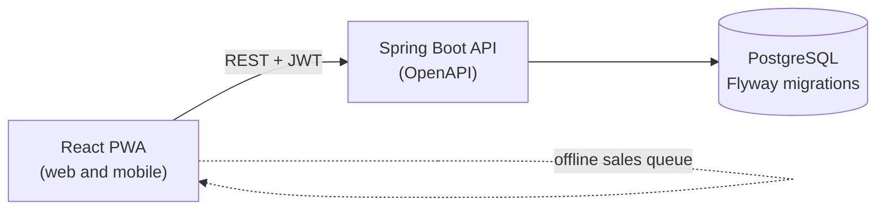

<div align="center">


<br />


[](https://github.com/Burst-Into-Fire/bandcore/actions/workflows/ci.yml)


**English** | [Português (Brasil)](docs/README-PTBR.md)

**[Features](#features)** · **[Architecture](#architecture)** · **[Getting started](#getting-started)** · **[Requirements](#requirements)** · **[Product Backlog](#product-backlog)** · **[Sprint Backlog](#sprint-backlog)** · **[Roadmap](#roadmap)** · **[Documentation](#documentation)**

</div>

<br />

## About

**bandcore** is a multi-band web and mobile (PWA) platform to manage shared expenses and merch. Every band gets its own account, with data fully isolated from every other band. Money is handled in Brazilian real (BRL) and US dollars (USD).

It started as an internal tool for **[Burst Into Fire](https://www.youtube.com/@BurstIntoFire)**, a modern metal band that blends in electronic music, and it is being built to be offered to other bands as a product.

> [!NOTE]
> bandcore is under active development and the repository is private for now. See the [Roadmap](#roadmap) for what comes next.

## The problem

Bands share costs (rehearsal space, gear, video, photography, travel) and sell merch at shows. In practice this lives in spreadsheets and group chats: one member fronts the money, nobody is sure who owes whom, stock counts drift, and nobody knows which product actually made a profit.

bandcore puts it all in one place: record costs, split them, track balances, and run merch sales, including at venues with bad signal.

<!-- Add screenshots here once the wireframes and first screens exist (docs/assets/). -->

## Features

<table>
<tr>
<td width="50%" valign="top">

### Module 1: Account management

- Expenses with future dates, categories and status (planned or paid)
- Record of who paid each expense
- Equal or custom split between members
- Running balance per member, with settlement payments
- Amounts in BRL and USD

</td>
<td width="50%" valign="top">

### Module 2: Merch

- Products with variations (size, color)
- Stock control per variation
- Quick sale from the phone
- Refunds that restore stock
- Prices and sales in BRL and USD

</td>
</tr>
</table>

**Right after the MVP:** offline sales with later sync, event closing, receipts, low-stock alerts, suggested settlements and CSV export.

**Where the two modules meet:** the cost of a merch batch can become an expense split among the members.

### Built to be trusted

| | Requirement | Stage |
|---|---|:---:|
| 🔒 | Full data isolation between bands | MVP |
| 🛡️ | Role-based authorization (admin, member, read-only), enforced in the backend | MVP |
| 💰 | Money stored as integer minor units with a currency code (BRL or USD), never floating point | MVP |
| 📦 | Sale and stock update in the same transaction, stock never negative | MVP |
| ✅ | Automated tests on the critical rules: splitting, balances, stock, refunds | MVP |
| 📱 | Responsive from 360 px, quick sale in a few taps | MVP |
| 🧾 | Audit trail of relevant actions | Next |
| ⚖️ | LGPD compliance (Brazilian data protection law) | Next |

## Architecture



| Layer | Technology |
|---|---|
| Backend | Java 21, Spring Boot, Maven, REST API documented with OpenAPI |
| Frontend | React, TypeScript, Vite, Tailwind CSS, installable PWA |
| Database | PostgreSQL with Flyway migrations |
| Auth | Spring Security with JWT (OAuth 2.0 planned) |
| Infrastructure | Docker, docker-compose locally, GitHub Actions |
| Deploy | Managed platform (Railway or Render, to be decided) with automatic deploys from GitHub |

The deploy is portable on purpose, so the project can move to a VPS with Docker Compose if cost or control requires it. Details in [Architecture](docs/ARCHTECTURE.md) and [Deployment](docs/DEPLOYMENT.md).

## Getting started

You only need Git and Docker. Full instructions, environment variables and running without Docker: [Getting Started](docs/GETTING-STARTED.md).

```bash
git clone https://github.com/Burst-Into-Fire/bandcore.git
cd bandcore
cp .env.example .env
docker compose up --build
```

Then open <http://app.localhost:3000>. Each band gets its own subdomain, such as <http://burst.localhost:3000>. Emails sent locally (verification links) land in Mailpit: <http://localhost:8025>.

Sessions work over plain HTTP locally: browsers treat `*.localhost` as a secure context, so the `Secure`, `__Host-` refresh cookie is stored and sent. Each subdomain has its own session.

| Task | Command |
|---|---|
| API unit and integration tests (needs Docker) | `cd api && ./mvnw verify` |
| Web lint, types and tests | `cd web && npm ci && npm run lint && npm run typecheck && npm test` |
| Whole stack smoke test | `scripts/compose-smoke-test.sh` |
| Enable the commit and branch hooks | `git config core.hooksPath .githooks` |

See [Testing](docs/TESTING.md) and [Contributing](docs/CONTRIBUTING.md) before opening a pull request.

## Requirements

The scope has **41 functional requirements**, **34 non-functional requirements** and **8 business rules**, grouped in 8 epics. Each requirement has a priority: **MVP**, **Next** or **Later**.

| # | Epic | Requirements | MVP items |
|:---:|:---|:---|:---:|
| E1 | Access and band | RF01 to RF07 | 4 |
| E2 | Expenses | RF08 to RF14 | 5 |
| E3 | Split and settlement | RF15 to RF20 | 4 |
| E4 | Merch: catalog and stock | RF21 to RF27 | 3 |
| E5 | Merch: sales | RF28 to RF33 | 4 |
| E6 | Accounts and merch integration | RF34 to RF35 | 0 |
| E7 | Reports and data | RF36 to RF39 | 1 |
| E8 | Currency (BRL and USD) | RF40 to RF41 | 1 |

<details>
<summary><b>Functional requirements (RF)</b></summary>

<br />

| ID | Requirement | Epic | Priority |
|:---|:---|:---|:---:|
| RF01 | Sign up and sign in | E1 | MVP |
| RF02 | Password recovery | E1 | Next |
| RF03 | Create a band | E1 | MVP |
| RF04 | Invite members | E1 | MVP |
| RF05 | Roles per band | E1 | MVP |
| RF06 | Multiple bands | E1 | Next |
| RF07 | Deactivate member | E1 | Later |
| RF08 | Register expense | E2 | MVP |
| RF09 | Future-dated expenses | E2 | MVP |
| RF10 | Default categories | E2 | MVP |
| RF11 | Custom categories | E2 | Next |
| RF12 | Edit, cancel and pay expenses | E2 | MVP |
| RF13 | Receipt attachment | E2 | Next |
| RF14 | List and filter expenses | E2 | MVP |
| RF15 | Equal split | E3 | MVP |
| RF16 | Custom split | E3 | MVP |
| RF17 | Member balances | E3 | MVP |
| RF18 | Settlement payments | E3 | MVP |
| RF19 | Suggested settlement | E3 | Next |
| RF20 | Manual income | E3 | Next |
| RF21 | Create products | E4 | MVP |
| RF22 | Product variations | E4 | MVP |
| RF23 | Product photo | E4 | Next |
| RF24 | Stock entry | E4 | MVP |
| RF25 | Stock adjustment | E4 | Next |
| RF26 | Low-stock alert | E4 | Next |
| RF27 | Deactivate product | E4 | Later |
| RF28 | Register sale | E5 | MVP |
| RF29 | Automatic stock deduction | E5 | MVP |
| RF30 | Refund sale | E5 | MVP |
| RF31 | Quick sale screen | E5 | MVP |
| RF32 | Offline sales | E5 | Next |
| RF33 | Event closing | E5 | Next |
| RF34 | Batch cost as expense | E6 | Next |
| RF35 | Merch profit allocation | E6 | Later |
| RF36 | Monthly summary | E7 | MVP |
| RF37 | Reports | E7 | Next |
| RF38 | CSV export | E7 | Next |
| RF39 | CSV import | E7 | Later |
| RF40 | Band default currency | E8 | MVP |
| RF41 | Manual exchange rate | E8 | Later |

</details>

<details>
<summary><b>Non-functional requirements (RNF)</b></summary>

<br />

| ID | Requirement | Group | Priority |
|:---|:---|:---|:---:|
| RNF01 | Tenant isolation | Security and privacy | MVP |
| RNF02 | Authentication | Security and privacy | MVP |
| RNF03 | Authorization | Security and privacy | MVP |
| RNF04 | Transport and secrets | Security and privacy | MVP |
| RNF05 | Login rate limit | Security and privacy | MVP |
| RNF06 | LGPD | Security and privacy | Next |
| RNF07 | Row Level Security | Security and privacy | Later |
| RNF08 | Money representation | Data integrity | MVP |
| RNF09 | Transactional sales | Data integrity | MVP |
| RNF10 | Non-negative stock | Data integrity | MVP |
| RNF11 | Audit trail | Data integrity | Next |
| RNF12 | Soft delete | Data integrity | Next |
| RNF13 | Idempotent sync | Data integrity | Next |
| RNF14 | Responsive layout | Usability and platform | MVP |
| RNF15 | Installable PWA | Usability and platform | Next |
| RNF16 | Fast sale | Usability and platform | MVP |
| RNF17 | Accessibility | Usability and platform | Next |
| RNF18 | Locale and time zone | Usability and platform | Next |
| RNF19 | Response time | Performance and availability | Next |
| RNF20 | Pagination | Performance and availability | Next |
| RNF21 | Availability | Performance and availability | Next |
| RNF22 | Initial sizing | Performance and availability | Next |
| RNF23 | Containers | Portability and deploy | MVP |
| RNF24 | Standard PostgreSQL | Portability and deploy | MVP |
| RNF25 | Environment configuration | Portability and deploy | MVP |
| RNF26 | CI/CD from GitHub | Portability and deploy | MVP |
| RNF27 | Separate environments | Portability and deploy | Next |
| RNF28 | Versioned migrations | Portability and deploy | MVP |
| RNF29 | Off-platform backups | Portability and deploy | MVP |
| RNF30 | API documentation | Maintainability and operations | Next |
| RNF31 | Tests on critical rules | Maintainability and operations | MVP |
| RNF32 | Logs and error monitoring | Maintainability and operations | Next |
| RNF33 | Health check | Maintainability and operations | Next |
| RNF34 | Cost ceiling | Maintainability and operations | Next |

</details>

The full descriptions and the business rules are in [docs/REQUIREMENTS.md](docs/REQUIREMENTS.md).

## Product Backlog

User stories are written from the requirements above and listed here with priority, estimate, sprint and related requirements. First drafts for Sprint 1:

| ID | Priority | Title | User Story | Estimate | Sprint | Related Requirements |
|:---|:---------|:------|:-----------|:--------:|:------:|:---------------------|
| US01 | Highest | Create account and sign in | As a band member, I want to create an account and sign in, so that I can access my band's data. | TBD | 01 | RF01, RNF02, RNF03, RNF05 |
| US02 | Highest | Create a band and invite members | As a band admin, I want to create my band and invite members with a role, so that everyone works in the same space. | TBD | 01 | RF03, RF04, RF05, RNF01 |
| US03 | High | Register and list expenses | As a band member, I want to register and filter expenses in BRL or USD, so that the band knows what it spends. | TBD | 01 | RF08, RF09, RF10, RF14, RF40, RNF08 |

## Sprint Backlog

**Sprint 1** (planned): documentation not yet available.

## Roadmap

The implementation plan, with milestones, issues, key decisions and the Definition of Done, is in [docs/roadmap.md](docs/roadmap.md).

- [ ] Project foundation: skeletons, database roles, tests, Docker and CI ([M1](docs/roadmap/M01-project-foundation.md), in progress)
- [ ] Account management module (in progress)
- [ ] Merch module (in progress)
- [ ] Press module (sending material to media outlets)
- [ ] Instagram integration
- [ ] Plans and billing in BRL and USD
- [ ] Open the repository to the public

## Documentation

### Project

| Document | Description |
|---|---|
| [Requirements](docs/REQUIREMENTS.md) | Full list of RF, RNF and business rules ([Português](docs/REQUIREMENTS-PTBR.md)) |
| Sprint 1 | Goal, scope and definition of done of the first sprint (documentation not yet available) |

### Technical

| Document | Description |
|---|---|
| [Getting Started](docs/GETTING-STARTED.md) | Prerequisites, environment variables and how to run the project |
| [Architecture](docs/ARCHTECTURE.md) | Components, project structure, multi-tenancy, money and offline sync |
| [Deployment](docs/DEPLOYMENT.md) | CI/CD, hosting, backups and how to move to a VPS |
| [Testing](docs/TESTING.md) | How to run the tests and which rules must be covered |
| [Database](docs/DATABASE.md) | Roles, migrations and the tenant table checklist |
| [Architecture decisions](docs/adr/README.md) | ADRs: modular monolith, multi-tenancy, authentication, money and more |
| [Roadmap](docs/roadmap.md) | Milestones, issues, testing strategy and Definition of Done |
| [Contributing](docs/CONTRIBUTING.md) | Branches, commits, pull requests and testing expectations |

<!-- License: decide when the repository is opened to the public. -->

<br />

<div align="center">

**Made with distortion and synths by [Burst Into Fire](https://www.youtube.com/@BurstIntoFire)**


</div>