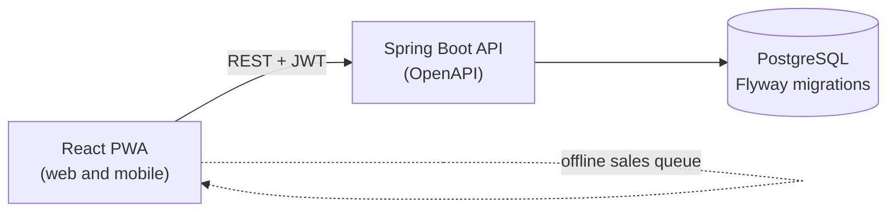

<div align="center">


<br />


<!-- [](https://github.com/Burst-Into-Fire/bandhub)
[](LICENSE) -->


**[Features](#features)** · **[Architecture](#architecture)** · **[Quick start](#quick-start)** · **[Tests](#running-the-tests)** · **[Deploy](#deployment)** · **[Roadmap](#roadmap)** · **[Contributing](#contributing)**

</div>

<br />

## About

**bandhub** is a multi-band web and mobile (PWA) platform to manage shared expenses and merch. Every band gets its own account, with data fully isolated from every other band.

It started as an internal tool for **[Burst Into Fire](https://www.youtube.com/@BurstIntoFire)**, a modern metal band that blends in electronic music, and it is being built to be offered to other bands as a product.

> [!NOTE]
> bandhub is under active development. The scope below describes the current version. See the [Roadmap](#roadmap) for what comes next.

## The problem

Bands share costs (rehearsal space, gear, video, photography, travel) and sell merch at shows. In practice this lives in spreadsheets and group chats: one member fronts the money, nobody is sure who owes whom, stock counts drift, and nobody knows which product actually made a profit.

bandhub puts it all in one place: record costs, split them, track balances, and run merch sales, including at venues with bad signal.

<!-- Replace with real screenshots or a short GIF of the quick sale flow -->
<div align="center">

| Quick sale (mobile) | Balances | Event closing |
|:---:|:---:|:---:|
| `[docs/assets/quick-sale.png]` | `[docs/assets/balances.png]` | `[docs/assets/event-closing.png]` |

</div>

## Features

<table>
<tr>
<td width="50%" valign="top">

### Module 1: Account management

- Expenses with future dates, categories, and status (planned or paid)
- Record of who paid each expense
- Split between members, equal or custom
- Running balance per member
- Payments between members to settle balances

</td>
<td width="50%" valign="top">

### Module 2: Merch

- Products with variations (size, color)
- Stock control per variation
- Sales from the phone, offline, with sync later
- Refunds that restore stock
- Event closing and profit per product

</td>
</tr>
</table>

**Where the two meet:** the cost of a merch batch can become an expense split among the members.

### Built to be trusted

| | Requirement |
|---|---|
| 🔒 | Full data isolation between bands |
| 🛡️ | Role-based authorization (admin, member, read-only), enforced in the backend |
| 💶 | Money stored in cents or `NUMERIC`, never floating point |
| 📦 | Sale and stock update in the same transaction, stock never negative |
| 🧾 | Audit trail of relevant actions |
| 📱 | Responsive from 360 px, quick sale in a few taps |
| ⚖️ | LGPD compliance (Brazilian data protection law) |
| ✅ | Automated tests on the critical rules: splitting, balances, stock, refunds |

## Architecture



| Layer | Technology |
|---|---|
| Backend | Java with Spring Boot, REST API documented with OpenAPI |
| Frontend | React, responsive PWA |
| Database | PostgreSQL with Flyway migrations |
| Infrastructure | Docker (API and frontend in containers), docker-compose locally |
| Deploy | Managed platform ([Railway or Render]) with automatic deploys from GitHub |

### Multi-tenancy

Every band is a tenant. [Describe the isolation strategy, for example a `band_id` column enforced in every query, Postgres row-level security, or both.]

### Reversible deploy

The deploy is portable on purpose, so the project can move to a VPS with Docker Compose if cost or control requires it:

- Only standard PostgreSQL features, no platform-specific extensions
- All configuration through environment variables
- Database backups stored outside the hosting platform

## Quick start

### Prerequisites

- [Docker and Docker Compose, minimum versions]
- [JDK version] (only to run the API outside Docker)
- [Node.js version] (only to run the frontend outside Docker)
- Git

### Run it

```bash
git clone [repository URL]
cd bandhub
cp .env.example .env
docker compose up --build
```

| Service | URL |
|---|---|
| Frontend | `[http://localhost:3000]` |
| API | `[http://localhost:8080]` |
| API docs (OpenAPI) | `[http://localhost:8080/swagger-ui.html]` |

Flyway migrations run automatically when the API starts. To stop everything:

```bash
docker compose down
```

<details>
<summary><b>Environment variables</b></summary>

<br />

| Variable | Description | Example |
|---|---|---|
| `POSTGRES_DB` | Database name | `bandhub` |
| `POSTGRES_USER` | Database user | `[user]` |
| `POSTGRES_PASSWORD` | Database password | `[password]` |
| `SPRING_DATASOURCE_URL` | JDBC connection URL | `jdbc:postgresql://db:5432/bandhub` |
| `JWT_SECRET` | Secret used to sign tokens | `[secret]` |
| `API_PORT` | API port | `[8080]` |
| `VITE_API_URL` | API URL used by the frontend | `[http://localhost:8080]` |


</details>

<details>
<summary><b>Running without Docker</b></summary>

<br />

```bash
# API
cd [backend folder]
./mvnw spring-boot:run

# Frontend
cd [frontend folder]
npm install
npm run dev
```

</details>

## Project structure

```text
bandhub/
├── [backend]/              Spring Boot API
│   ├── src/main/java/      Application code
│   ├── src/main/resources/
│   │   └── db/migration/   Flyway migrations
│   └── src/test/java/      Backend tests
├── [frontend]/             React PWA
│   ├── src/
│   └── public/
├── docker-compose.yml
├── .env.example
└── README.md
```


## Running the tests

```bash
# Backend
cd [backend folder]
./mvnw test

# Frontend
cd [frontend folder]
npm test
```

Tests prioritize the critical business rules: expense splitting, member balances, stock control, and refunds. [Add the integration test command, for example with Testcontainers, if applicable.]

## Deployment

A push to `main` runs the tests, builds the images, and publishes to [Railway or Render].

1. Create the project on [Railway or Render] and connect the GitHub repository
2. Provision a managed PostgreSQL instance
3. Set the environment variables in the platform settings
4. Enable automatic deploys from `main`
5. Schedule database backups to a location outside the platform: [backup destination and frequency]

<details>
<summary><b>Moving to a VPS</b></summary>

<br />

1. Restore the latest database backup on the new host
2. Copy the environment variables to the new `.env`
3. Run `docker compose -f [production compose file] up -d`
4. Point DNS to the new host

</details>

## Roadmap

- [x] Account management module
- [x] Merch module
- [ ] Press module (sending material to media outlets)
- [ ] Instagram integration
- [ ] Plans and billing

 <!-- 
## Contributing

Contributions are welcome.

1. Fork the repository
2. Create a branch: `git checkout -b feature/short-description`
3. Make your changes and add tests for any business rule you touch
4. Make sure all tests pass
5. Open a pull request describing what changed and why


## License -->


<br />

<div align="center">

**Made with distortion and synths by [Burst Into Fire]([band link])**


</div>