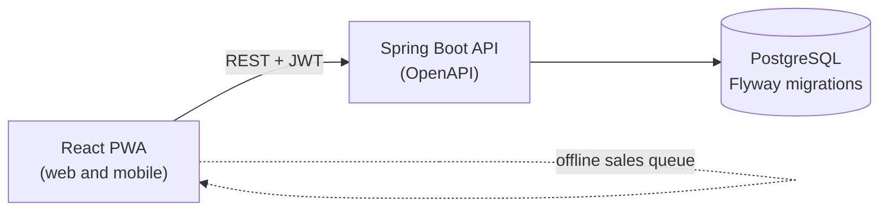

# Architecture

## Overview



The web app talks only to the API. All business rules live in the Java backend. The database is never accessed directly from the browser.

## Project structure

```text
bandcore/
├── .github/workflows/        CI/CD, filtered by folder (api, web)
├── api/                      Spring Boot API (Java 21, Maven)
│   ├── src/main/java/        Application code
│   ├── src/main/resources/
│   │   ├── db/migration/     Flyway migrations
│   │   └── application.yml   Configuration (values come from environment variables)
│   └── src/test/java/        Backend tests
├── web/                      React PWA (TypeScript, Vite)
├── docs/                     Project documentation
├── docker-compose.yml        api, web and PostgreSQL for local development
├── .env.example              Template for environment variables
├── ruleset.json              GitHub ruleset
└── README.md
```

## Backend

Organize the code by feature rather than by layer, so each module owns its controller, service, repository and tests:

```text
com.burstintofire.bandcore
├── band/        bands, members, roles, invitations
├── auth/        sign up, sign in, tokens
├── expense/     expenses, categories, shares
├── settlement/  balances and settlement payments
├── merch/       products, variations, stock
├── sale/        sales, refunds, event closing
└── shared/      money, tenant context, error handling
```

Adjust the base package to the one in your `pom.xml`.

### Multi-tenancy

Every band is a tenant. Rules:

- Every business table has a `band_id` column.
- The `band_id` comes from the authenticated user's token and the selected band, never from a request parameter the client can change.
- Every repository query filters by `band_id`. A shared tenant context makes this hard to forget.
- Automated tests try to read and change another band's data and must fail (RNF01).
- PostgreSQL Row Level Security can be added later as a second barrier (RNF07).

### Money

- Amounts are stored as integers in the smallest unit of the currency (`amount_minor`), next to an ISO 4217 code in a `currency` column restricted to `BRL` and `USD` (RNF08).
- Use a small `Money` value object in Java so arithmetic and currency checks live in one place.
- Amounts in different currencies are never added together. Balances and totals are computed per currency (RN08).
- Splitting rounds in minor units and assigns the remainder deterministically, so shares always add up to the total (RN01).

### Sales and stock

- A sale and its stock deduction run in one transaction (RNF09).
- A `CHECK (quantity >= 0)` constraint on stock is the last line of defense (RNF10).
- A sale stores the price and cost in effect at that moment (RN05).
- Sales and expenses are soft-deleted, with an audit record for changes (RNF11, RNF12).

### Authentication

Spring Security with JWT: a short-lived access token plus a refresh token. OAuth 2.0 can be added later without changing the rest of the API. Authorization is checked in the backend by role (RNF03).

### API conventions

- REST with JSON, documented with OpenAPI (springdoc).
- Errors follow the Problem Details format (RFC 9457).
- Lists are paginated and filterable.

## Web

- React with TypeScript and Vite, styled with Tailwind CSS.
- Installable PWA through `vite-plugin-pwa`.
- Suggested libraries: React Router for navigation, TanStack Query for server data, React Hook Form with Zod for forms, and Vitest with Testing Library for tests.
- Texts are externalized for pt-BR and English from the start (RNF18).

### Offline sales

Offline support is planned right after the MVP (RF32, RNF13). The design:

1. The quick sale screen writes the sale to a local queue (IndexedDB) with a client-generated UUID.
2. When the connection returns, the queue is sent to the API in order.
3. The API treats the UUID as an idempotency key, so a retried request never creates a duplicate sale.

## Reversible deploy

The hosting choice must stay reversible, so the project can move from a managed platform to a VPS with Docker Compose:

- Only standard PostgreSQL features, no platform-specific extensions (RNF24).
- All configuration through environment variables (RNF25).
- Database backups stored outside the hosting platform (RNF29).
- API and web built as Docker images (RNF23).

See [Deployment](DEPLOYMENT.md).