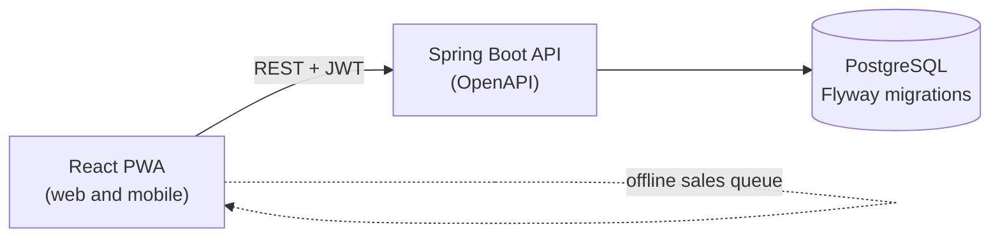

# Architecture

## Overview



The web app talks only to the API. All business rules live in the Java backend. The database is never accessed directly from the browser.

## Project structure

```text
bandcore/
├── .github/
│   ├── workflows/            CI, security scans, commit and branch standards
│   ├── ISSUE_TEMPLATE/       Feature, bug, chore and security templates
│   ├── pull_request_template.md   Definition of Done checklist
│   ├── CODEOWNERS, SECURITY.md, dependabot.yml
├── .githooks/                commit-msg, pre-push and post-checkout hooks
├── api/                      Spring Boot API (Java 21, Maven)
│   ├── db/bootstrap/         Creates the database roles and schema (local and managed)
│   ├── src/main/java/        Application code, one package per module
│   ├── src/main/resources/
│   │   ├── db/migration/     Flyway migrations
│   │   ├── application.yml   Configuration (values come from environment variables)
│   │   └── application-prod.yml   Production profile: no defaults, fails fast
│   ├── src/test/java/        Unit (*Test) and integration (*IT) tests
│   └── Dockerfile
├── web/                      React PWA (TypeScript, Vite)
│   ├── src/api/              Typed API client generated from OpenAPI
│   ├── src/i18n/             Translations (pt-BR)
│   ├── src/lib/              Money and date helpers
│   ├── nginx/                nginx config: SPA and /api reverse proxy
│   └── Dockerfile
├── docs/                     Documentation, ADRs (docs/adr), security notes (docs/security), roadmap
├── scripts/                  Compose smoke test and repository checks
├── docker-compose.yml        db, api, web and mailpit for local development
├── .env.example              Template for environment variables
├── ruleset.json              GitHub ruleset
└── README.md
```

## Backend

A modular monolith with Spring Modulith ([ADR-0001](adr/0001-modular-monolith-with-spring-modulith.md)). Each top-level package is a module that owns its controllers, services, repositories and tests:

```text
com.burstintofire.bandcore
├── identity/    accounts, credentials, sessions and tokens
├── tenancy/     bands, tenant resolution, members, memberships and roles
├── finance/     expenses, categories, splits, balances and settlements
├── merch/       products, variants, stock, batches, sales, refunds and events
├── audit/       append-only audit trail
└── shared/      error handling, request id, clock, security baseline, Money
```

- The root package of a module is its public API; subpackages are internal. `shared` is open to every module and depends on none. `ModularityTest` verifies this on every build.
- Every route is under `/api`. Health endpoints run on a separate management port (8081) that the public proxy never routes.
- Errors are RFC 9457 Problem Details (`application/problem+json`) with a stable `code` and the `requestId`, and never contain stack traces or SQL.
- Every request carries an `X-Request-Id` (generated or propagated), stored in the log context and returned in the response. Logs are structured JSON.
- Time is read only through an injected `java.time.Clock`, so tests can fix it.

### Multi-tenancy

Every band is a tenant. Rules:

- Every business table has a `band_id` column.
- The `band_id` comes from the authenticated user's token and the band of the request, never from a request parameter the client can change.
- Every repository query filters by `band_id`. A shared tenant context makes this hard to forget.
- Automated tests try to read and change another band's data and must fail (RNF01).
- PostgreSQL Row Level Security as a second barrier, with the API connected as a role that cannot bypass it. The roadmap proposes RLS from M2, while the requirements place it later (RNF07); see [ADR-0002](adr/0002-multi-tenancy-shared-schema-band-id-rls.md). The least-privilege roles are already in place ([Database](DATABASE.md)).

### Money

- Amounts are stored as integers in the smallest unit of the currency (`amount_minor`), next to an ISO 4217 code in a `currency` column restricted to `BRL` and `USD` (RNF08).
- Use a small `Money` value object in Java so arithmetic and currency checks live in one place.
- Amounts in different currencies are never added together. Balances and totals are computed per currency (RN08).
- Splitting rounds in minor units and assigns the remainder deterministically, so shares always add up to the total (RN01).

### Sales and stock

- A sale and its stock deduction run in one transaction (RNF09).
- A `CHECK (quantity >= 0)` constraint on stock is the last line of defense (RNF10).
- A sale stores the price and cost in effect at that moment (RN05).
- Sales and expenses are soft-deleted, with an audit record for changes (RNF11, RNF12).

### Authentication

Spring Security with JWT: a short-lived access token plus a refresh token. OAuth 2.0 can be added later without changing the rest of the API. Authorization is checked in the backend by role (RNF03).

### API conventions

- REST with JSON, documented with OpenAPI (springdoc).
- Errors follow the Problem Details format (RFC 9457).
- Lists are paginated and filterable.

## Web

- React with TypeScript and Vite, styled with Tailwind CSS.
- Installable PWA through `vite-plugin-pwa`.
- Libraries: React Router for navigation, TanStack Query for server data, React Hook Form with Zod for forms, and Vitest with Testing Library and MSW for tests.
- Texts are externalized with react-i18next; pt-BR is the default language and a lint rule rejects hardcoded UI text (RNF18).
- The API client is typed from the OpenAPI document (`npm run api:generate`); CI fails if it is out of date.
- Design tokens from the mockup (dark background, surface cards, muted text, coral accent) are defined in `web/src/index.css`.

### Offline sales

Offline support is planned right after the MVP (RF32, RNF13). The design:

1. The quick sale screen writes the sale to a local queue (IndexedDB) with a client-generated UUID.
2. When the connection returns, the queue is sent to the API in order.
3. The API treats the UUID as an idempotency key, so a retried request never creates a duplicate sale.

## Reversible deploy

The hosting choice must stay reversible, so the project can move from a managed platform to a VPS with Docker Compose:

- Only standard PostgreSQL features, no platform-specific extensions (RNF24).
- All configuration through environment variables (RNF25).
- Database backups stored outside the hosting platform (RNF29).
- API and web built as Docker images (RNF23).

See [Deployment](DEPLOYMENT.md).