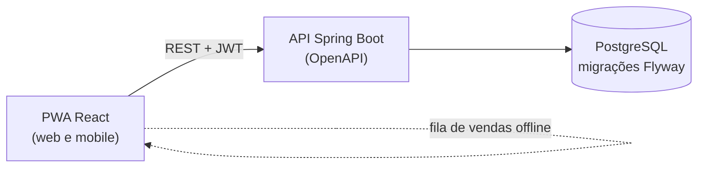

 

<!-- CI badge: only renders for visitors once the repository is public.
 -->

[English](../README.md) | **Português (Brasil)**

**[Funcionalidades](#funcionalidades)** · **[Arquitetura](#arquitetura)** · **[Requisitos](#requisitos)** · **[Product Backlog](#product-backlog)** · **[Sprint Backlog](#sprint-backlog)** · **[Roadmap](#roadmap)** · **[Documentação](#documentação)**

 

## Sobre

O **bandcore** é uma plataforma multi-banda, web e mobile (PWA), para gerenciar gastos compartilhados e merch. Cada banda tem a própria conta, com os dados totalmente isolados das outras bandas. O dinheiro é tratado em real (BRL) e dólar (USD).

Começou como uma ferramenta interna da **[Burst Into Fire](https://www.youtube.com/@BurstIntoFire)**, uma banda de metal moderno que mistura música eletrônica, e está sendo construído para ser oferecido a outras bandas como produto.

> [!NOTE]
> O bandcore está em desenvolvimento ativo e o repositório está privado por enquanto. Veja o [Roadmap](#roadmap) para os próximos passos.

## O problema

Bandas dividem custos (sala de ensaio, equipamento, vídeo, fotografia, viagens) e vendem merch nos shows. Na prática isso mora em planilhas e grupos de mensagem: um integrante adianta o dinheiro, ninguém tem certeza de quem deve a quem, o estoque não bate e ninguém sabe qual produto realmente deu lucro.

O bandcore junta tudo em um só lugar: registrar custos, dividir, acompanhar saldos e vender merch, inclusive em locais com sinal ruim.

<!-- Adicione screenshots aqui quando os wireframes e as primeiras telas existirem (docs/assets/). -->

## Funcionalidades

<table>
<tr>
<td width="50%" valign="top">

### Módulo 1: Gestão de contas

- Gastos com data futura, categorias e status (previsto ou pago)
- Registro de quem pagou cada gasto
- Divisão igual ou personalizada entre integrantes
- Saldo de cada integrante, com pagamentos de acerto
- Valores em BRL e USD

</td>
<td width="50%" valign="top">

### Módulo 2: Merch

- Produtos com variações (tamanho, cor)
- Controle de estoque por variação
- Venda rápida pelo celular
- Estornos que devolvem o estoque
- Preços e vendas em BRL e USD

</td>
</tr>
</table>

**Logo depois do MVP:** vendas offline com sincronização, fechamento de evento, comprovantes, alertas de estoque baixo, acerto sugerido e exportação em CSV.

**Onde os dois módulos se encontram:** o custo de um lote de merch pode virar um gasto dividido entre os integrantes.

### Feito para ser confiável

| | Requisito | Etapa |
|---|---|:---:|
| 🔒 | Isolamento total dos dados entre bandas | MVP |
| 🛡️ | Autorização por perfil (admin, integrante, somente leitura), aplicada no backend | MVP |
| 💰 | Dinheiro guardado como inteiro na menor unidade, com código da moeda (BRL ou USD), nunca em ponto flutuante | MVP |
| 📦 | Venda e baixa de estoque na mesma transação, estoque nunca negativo | MVP |
| ✅ | Testes automatizados nas regras críticas: divisão, saldos, estoque, estornos | MVP |
| 📱 | Responsivo a partir de 360 px, venda rápida em poucos toques | MVP |
| 🧾 | Trilha de auditoria das ações relevantes | Em seguida |
| ⚖️ | Conformidade com a LGPD | Em seguida |

## Arquitetura

| Camada | Tecnologia |
|---|---|
| Backend | Java 21, Spring Boot, Maven, API REST documentada com OpenAPI |
| Frontend | React, TypeScript, Vite, Tailwind CSS, PWA instalável |
| Banco de dados | PostgreSQL com migrações Flyway |
| Autenticação | Spring Security com JWT (OAuth 2.0 planejado) |
| Infraestrutura | Docker, docker-compose local, GitHub Actions |
| Deploy | Plataforma gerenciada (Railway ou Render, a decidir) com deploy automático pelo GitHub |

O deploy é portátil de propósito, para o projeto poder migrar para uma VPS com Docker Compose se custo ou controle exigirem. Detalhes em [Architecture](ARCHTECTURE.md) e [Deployment](DEPLOYMENT.md) (em inglês).

## Requisitos

O escopo tem **41 requisitos funcionais**, **34 requisitos não funcionais** e **8 regras de negócio**, agrupados em 8 épicos. Cada requisito tem uma prioridade: **MVP**, **Em seguida** ou **Depois**.

| # | Épico | Requisitos | Itens do MVP |
|:---:|:---|:---|:---:|
| E1 | Acesso e banda | RF01 a RF07 | 4 |
| E2 | Gastos | RF08 a RF14 | 5 |
| E3 | Divisão e acerto | RF15 a RF20 | 4 |
| E4 | Merch: catálogo e estoque | RF21 a RF27 | 3 |
| E5 | Merch: vendas | RF28 a RF33 | 4 |
| E6 | Integração entre contas e merch | RF34 a RF35 | 0 |
| E7 | Relatórios e dados | RF36 a RF39 | 1 |
| E8 | Moedas (BRL e USD) | RF40 a RF41 | 1 |

<b>Requisitos funcionais (RF)</b>

 

| ID | Requisito | Épico | Prioridade |
|:---|:---|:---|:---:|
| RF01 | Cadastro e login | E1 | MVP |
| RF02 | Recuperação de senha | E1 | Em seguida |
| RF03 | Criar banda | E1 | MVP |
| RF04 | Convidar integrantes | E1 | MVP |
| RF05 | Perfis por banda | E1 | MVP |
| RF06 | Várias bandas | E1 | Em seguida |
| RF07 | Desativar integrante | E1 | Depois |
| RF08 | Cadastrar gasto | E2 | MVP |
| RF09 | Gastos com data futura | E2 | MVP |
| RF10 | Categorias padrão | E2 | MVP |
| RF11 | Categorias personalizadas | E2 | Em seguida |
| RF12 | Editar, cancelar e pagar gastos | E2 | MVP |
| RF13 | Anexar comprovante | E2 | Em seguida |
| RF14 | Listar e filtrar gastos | E2 | MVP |
| RF15 | Divisão igual | E3 | MVP |
| RF16 | Divisão personalizada | E3 | MVP |
| RF17 | Saldo por integrante | E3 | MVP |
| RF18 | Pagamentos de acerto | E3 | MVP |
| RF19 | Acerto sugerido | E3 | Em seguida |
| RF20 | Receitas manuais | E3 | Em seguida |
| RF21 | Cadastrar produtos | E4 | MVP |
| RF22 | Variações de produto | E4 | MVP |
| RF23 | Foto do produto | E4 | Em seguida |
| RF24 | Entrada de estoque | E4 | MVP |
| RF25 | Ajuste de estoque | E4 | Em seguida |
| RF26 | Alerta de estoque baixo | E4 | Em seguida |
| RF27 | Desativar produto | E4 | Depois |
| RF28 | Registrar venda | E5 | MVP |
| RF29 | Baixa automática de estoque | E5 | MVP |
| RF30 | Estornar venda | E5 | MVP |
| RF31 | Tela de venda rápida | E5 | MVP |
| RF32 | Vendas offline | E5 | Em seguida |
| RF33 | Fechamento de evento | E5 | Em seguida |
| RF34 | Custo do lote como gasto | E6 | Em seguida |
| RF35 | Destino do lucro do merch | E6 | Depois |
| RF36 | Resumo mensal | E7 | MVP |
| RF37 | Relatórios | E7 | Em seguida |
| RF38 | Exportar CSV | E7 | Em seguida |
| RF39 | Importar CSV | E7 | Depois |
| RF40 | Moeda padrão da banda | E8 | MVP |
| RF41 | Taxa de câmbio manual | E8 | Depois |

<b>Requisitos não funcionais (RNF)</b>

 

| ID | Requisito | Grupo | Prioridade |
|:---|:---|:---|:---:|
| RNF01 | Isolamento entre bandas | Segurança e privacidade | MVP |
| RNF02 | Autenticação | Segurança e privacidade | MVP |
| RNF03 | Autorização | Segurança e privacidade | MVP |
| RNF04 | Transporte e segredos | Segurança e privacidade | MVP |
| RNF05 | Limite de tentativas de login | Segurança e privacidade | MVP |
| RNF06 | LGPD | Segurança e privacidade | Em seguida |
| RNF07 | Row Level Security | Segurança e privacidade | Depois |
| RNF08 | Representação de dinheiro | Integridade dos dados | MVP |
| RNF09 | Venda transacional | Integridade dos dados | MVP |
| RNF10 | Estoque não negativo | Integridade dos dados | MVP |
| RNF11 | Trilha de auditoria | Integridade dos dados | Em seguida |
| RNF12 | Exclusão lógica | Integridade dos dados | Em seguida |
| RNF13 | Sincronização idempotente | Integridade dos dados | Em seguida |
| RNF14 | Layout responsivo | Usabilidade e plataforma | MVP |
| RNF15 | PWA instalável | Usabilidade e plataforma | Em seguida |
| RNF16 | Venda rápida | Usabilidade e plataforma | MVP |
| RNF17 | Acessibilidade | Usabilidade e plataforma | Em seguida |
| RNF18 | Idioma e fuso horário | Usabilidade e plataforma | Em seguida |
| RNF19 | Tempo de resposta | Desempenho e disponibilidade | Em seguida |
| RNF20 | Paginação | Desempenho e disponibilidade | Em seguida |
| RNF21 | Disponibilidade | Desempenho e disponibilidade | Em seguida |
| RNF22 | Dimensionamento inicial | Desempenho e disponibilidade | Em seguida |
| RNF23 | Containers | Portabilidade e deploy | MVP |
| RNF24 | PostgreSQL padrão | Portabilidade e deploy | MVP |
| RNF25 | Configuração por ambiente | Portabilidade e deploy | MVP |
| RNF26 | CI/CD pelo GitHub | Portabilidade e deploy | MVP |
| RNF27 | Ambientes separados | Portabilidade e deploy | Em seguida |
| RNF28 | Migrações versionadas | Portabilidade e deploy | MVP |
| RNF29 | Backups fora da plataforma | Portabilidade e deploy | MVP |
| RNF30 | Documentação da API | Manutenção e operação | Em seguida |
| RNF31 | Testes nas regras críticas | Manutenção e operação | MVP |
| RNF32 | Logs e monitoramento de erros | Manutenção e operação | Em seguida |
| RNF33 | Health check | Manutenção e operação | Em seguida |
| RNF34 | Teto de custo | Manutenção e operação | Em seguida |

As descrições completas e as regras de negócio estão em [docs/REQUIREMENTS-PTBR.md](REQUIREMENTS-PTBR.md).

## Product Backlog

As user stories são escritas a partir dos requisitos acima e listadas aqui com prioridade, estimativa, sprint e requisitos relacionados. Primeiros rascunhos da Sprint 1:

| ID | Prioridade | Título | User Story | Estimativa | Sprint | Requisitos relacionados |
|:---|:-----------|:-------|:-----------|:----------:|:------:|:------------------------|
| US01 | Máxima | Criar conta e entrar | Como integrante de uma banda, quero criar uma conta e entrar, para acessar os dados da minha banda. | A definir | 01 | RF01, RNF02, RNF03, RNF05 |
| US02 | Máxima | Criar banda e convidar integrantes | Como admin da banda, quero criar minha banda e convidar integrantes com um perfil, para que todos trabalhem no mesmo espaço. | A definir | 01 | RF03, RF04, RF05, RNF01 |
| US03 | Alta | Cadastrar e listar gastos | Como integrante, quero cadastrar e filtrar gastos em BRL ou USD, para que a banda saiba quanto gasta. | A definir | 01 | RF08, RF09, RF10, RF14, RF40, RNF08 |

## Sprint Backlog

**Sprint 1** (planejada): documentação ainda não disponível (em inglês)

## Roadmap

- [ ] Módulo de gestão de contas (em andamento)
- [ ] Módulo de merch (em andamento)
- [ ] Módulo de imprensa (envio de material para veículos)
- [ ] Integração com o Instagram
- [ ] Planos e cobrança em BRL e USD
- [ ] Abrir o repositório ao público

## Documentação

### Projeto

| Documento | Descrição |
|---|---|
| [Requisitos](REQUIREMENTS-PTBR.md) | Lista completa de RF, RNF e regras de negócio ([English](REQUIREMENTS.md)) |
| Sprint 1 | Objetivo, escopo e definição de pronto da primeira sprint (documentação ainda não disponível) |

### Técnica (em inglês)

| Documento | Descrição |
|---|---|
| [Getting Started](GETTING-STARTED.md) | Pré-requisitos, variáveis de ambiente e como rodar o projeto |
| [Architecture](ARCHTECTURE.md) | Componentes, estrutura do projeto, multi-tenancy, dinheiro e sincronização offline |
| [Deployment](DEPLOYMENT.md) | CI/CD, hospedagem, backups e como migrar para uma VPS |
| [Testing](TESTING.md) | Como rodar os testes e quais regras precisam de cobertura |

<!-- Licença: decidir quando o repositório for aberto ao público. -->

 

**Feito com distorção e sintetizadores pela [Burst Into Fire](https://www.youtube.com/@BurstIntoFire)**

