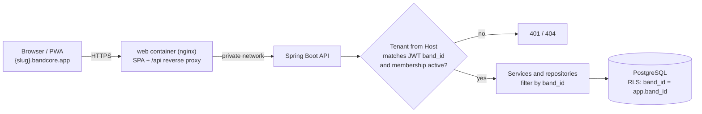
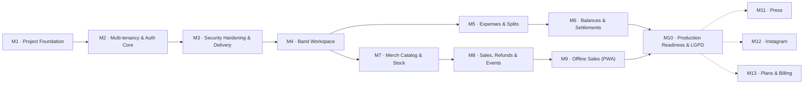

# bandcore roadmap

This document is the implementation plan for bandcore: product scope, architecture decisions, testing strategy, Definition of Done, and the full list of milestones and issues. Each milestone has its own file in [`docs/roadmap/`](roadmap/) with complete issue descriptions.

> [!NOTE]
> Status: **planning**. Milestones, labels and issues will be created on GitHub from these files once repository permissions are in place (see [Turning these files into GitHub issues](#turning-these-files-into-github-issues)).

## Contents

- [Product summary](#product-summary)
- [Key decisions](#key-decisions)
- [Open points with the requirements docs](#open-points-with-the-requirements-docs)
- [Reference architecture](#reference-architecture)
- [Testing strategy](#testing-strategy)
- [Definition of Done](#definition-of-done)
- [Permission matrix (proposal)](#permission-matrix-proposal)
- [Labels](#labels)
- [Milestones](#milestones)
- [Issue index](#issue-index)
- [Deferred decisions](#deferred-decisions)
- [Turning these files into GitHub issues](#turning-these-files-into-github-issues)

## Product summary

bandcore is a multi-tenant SaaS (web + PWA) for bands to manage shared expenses and merch. Every band is a tenant with its own subdomain (`{slug}.bandcore.app`) and must never see or affect another band's data.

| Module | Scope |
|---|---|
| **1. Account management** | Expenses (future dates, categories, planned or paid), who paid, equal or custom splits between members, running balance per member, settlement payments, suggested settlements |
| **2. Merch** | Products with variants (size, color), stock per variant, quick sales from the phone (also offline, synced later), refunds that restore stock, events (shows) with closing report and profit per product |
| **Where they meet** | The cost of a merch production batch can become an expense split among members |

Non-functional requirements (from the README): full data isolation between bands, role-based authorization enforced in the backend, money never stored as floating point, sale and stock update in the same transaction with stock never negative, audit trail, responsive from 360 px, LGPD compliance, automated tests on the critical rules.

The dashboard mockup (summary page) defines the UI direction: dark theme, left sidebar with *Resumo / Gastos / Merch / Integrantes*, a primary coral action (*Novo gasto*), KPI cards (*Gastos do mês*, *Vendas de merch*, *Lucro do merch*), a member settlement card (*Acerto entre integrantes*), a stock card with low-stock warnings, and a latest-expenses list with paid/planned status.

## Key decisions

| Topic | Decision | Why |
|---|---|---|
| Tenant isolation | Shared schema, `band_id` on every tenant table, filtered by the application **and** enforced by PostgreSQL Row-Level Security (`ENABLE` + `FORCE`), fail-closed when no tenant is set | Defense in depth: a single missed `WHERE` cannot leak data; scales to many bands with one set of migrations; standard PostgreSQL only |
| Users and members | Global accounts (one email = one account) with a membership per band and a role per band. A *member* (integrante) can exist without a login | Musicians often play in several bands; some members never use the app but still share costs |
| Authentication | Built with Spring Security: Argon2id passwords, short-lived JWT access token kept in memory, opaque rotating refresh token in an `HttpOnly` host-only cookie | No external dependency or per-user cost; portable to a VPS; tokens scoped per band subdomain |
| Onboarding | Self-service: sign up, verify email, create a band and choose its subdomain | Prepares the ground for plans and billing |
| Offline sale conflicts | A synced sale that exceeds available stock is stored as `PENDING_RECONCILIATION` without touching stock; an admin resolves it with an inventory adjustment or a cancellation | The money and the product already changed hands, so the record must not be lost, and stock must never go negative |
| Profit | Cost of goods sold (COGS) using the weighted average unit cost of production batches, snapshotted on each sold item | Correct per event and per product even when stock is left over |
| Language | Code, docs and issues in English; UI in pt-BR with i18n in place | Matches the README; ready for other languages later |

These decisions are recorded as ADRs in [M1-02](roadmap/M01-project-foundation.md).

## Open points with the requirements docs

`docs/REQUIREMENTS.md` and `docs/ARCHTECTURE.md` were written in parallel with this roadmap and differ on a few decisions. Issues affected by them carry the `needs-discussion` label and an *Open question* section.

| Topic | This roadmap | Requirements docs | Affected issues |
|---|---|---|---|
| Row Level Security | In M2, as part of tenant isolation | *Later* (RNF07) | **Decided 2026-10-30:** in M2 ([ADR-0002](adr/0002-multi-tenancy-shared-schema-band-id-rls.md)) |
| One subdomain per band | Tenant resolved from the subdomain; sessions scoped per host | Not mentioned; tenant from the token and a selected band | **Decided 2026-10-30:** subdomain per band ([ADR-0005](adr/0005-subdomain-per-band-same-origin-api.md)); M1-10 still validates the platform |
| Multiple bands per user | From the start (global accounts) | *Next* (RF06) | **Decided 2026-10-30:** global accounts ([ADR-0003](adr/0003-global-accounts-per-band-memberships.md)); UI in M4-05 |
| Currency | BRL only | BRL and USD, totals and balances per currency (RF40, RNF08, RN08) | M5-01, M5-03, M5-04, M6-01, M6-02, M6-04, M7-01, M8-02, M8-05 |
| Product unit cost | Weighted average of production batches | Entered on the product (RF21) | M7-01, M7-03, M8-04 |

Priorities also differ: the requirements mark password recovery, audit trail, soft delete, LGPD, OpenAPI and health check as *Next*, while this roadmap places several of them before the business modules. Requirements not yet covered here: receipt attachment (RF13), manual income (RF20), product photo (RF23), sale discount (RF28), merch profit allocation (RF35), reports and CSV (RF37 to RF39), exchange rate (RF41) and English UI from the start (RNF18).

## Reference architecture

**Backend.** Java 21 LTS, Spring Boot 4.x, Maven wrapper. A modular monolith with Spring Modulith; top-level modules `identity`, `tenancy`, `finance`, `merch`, `audit` and `shared`, with boundaries verified in tests. Future modules (press, Instagram, billing) are added as new modules. OpenAPI via springdoc; errors as RFC 9457 Problem Details.

**Routing.** Wildcard DNS `*.{BASE_DOMAIN}`. `app.{BASE_DOMAIN}` is the central host (sign up, create band, "my bands"); `{slug}.{BASE_DOMAIN}` is a band. The web container serves the SPA and proxies `/api` to the API, so the API is same-origin on every host: no CORS, and cookies are host-only per band. The tenant is resolved from the `Host` header; forwarded headers are trusted only from the configured proxy. Each subdomain is a separate browser origin, so IndexedDB and localStorage are isolated per band for free. Local development uses `*.localhost`.

**Tenant isolation in three layers.**

1. Every authenticated request: the JWT `band_id` must equal the band resolved from `Host`, and the membership is re-checked (short cache, evicted on change).
2. Repositories always filter by the current band.
3. PostgreSQL RLS: at the start of each transaction the API runs `set_config('app.band_id', …, true)` (transaction-local, so pooled connections never carry a previous tenant). Policies compare `band_id` against that setting and return nothing when it is unset. The API connects as `bandcore_app`, which owns no tables and has no `BYPASSRLS`; Flyway runs as the owner role. Composite foreign keys `(band_id, id)` prevent a child row from pointing to another band's parent. Cross-tenant access returns 404.

**Data conventions.** UUIDv7 identifiers generated by the application (offline sales use a client-generated UUID as idempotency key). Money as `BIGINT` cents with a `Money` value object and deterministic cent allocation. Stock with `CHECK (quantity >= 0)`, atomic conditional decrements and an append-only `stock_movements` ledger. Timestamps as `timestamptz`; month boundaries computed in the band's timezone.

**Frontend.** React + TypeScript (strict) + Vite, React Router, TanStack Query, react-hook-form + zod, Tailwind CSS with design tokens from the mockup, react-i18next (pt-BR), a typed API client generated from OpenAPI (openapi-typescript + openapi-fetch) with a drift check in CI, PWA via vite-plugin-pwa (Workbox), offline queue in IndexedDB (Dexie).

**Infrastructure.** Multi-stage, non-root Docker images; docker-compose locally (db, api, web, mailpit). Hosting on Railway or Render, decided by the spike in [M1-10](roadmap/M01-project-foundation.md). Only standard PostgreSQL features, configuration through environment variables, and backups stored outside the platform, so the deploy can move to a VPS.

## Testing strategy

Integration tests are the main layer. The goal is that every rule that protects money, stock or tenant isolation is proven against a real database.

| Layer | What it covers | Tools |
|---|---|---|
| **Integration (primary)** | Every use case through the HTTP API against real PostgreSQL (same image as production), with the API connected as `bandcore_app` so RLS is exercised exactly as in production | `@SpringBootTest`, Testcontainers, Failsafe (`*IT`) |
| **Security guards (every PR)** | *Schema guard:* every table with `band_id` has RLS enabled, forced and covered by policies; the app role owns nothing and cannot bypass RLS. *Isolation harness:* two bands; every endpoint is tested with band A's token on band B's host, band B's IDs, tampered/expired/missing tokens; an enumeration test fails if a new endpoint is neither covered nor explicitly public. *Authorization matrix:* role × endpoint | JUnit 5, Testcontainers |
| **Unit and property-based** | Allocation (parts always sum to the total), balances (always sum to zero), settlement plan (always zeroes balances), weighted average cost, COGS | JUnit 5, AssertJ, jqwik |
| **Concurrency** | N parallel sales of the last unit: exactly the possible ones succeed and stock never goes negative; double refunds; last-admin removal | Integration tests with parallel executors |
| **Architecture** | Module boundaries; no `float`/`double` for money; `users` table only accessed by `identity` | Spring Modulith `verify()`, ArchUnit |
| **Mutation** | Finance and merch domain packages | PIT |
| **Frontend** | Component and logic tests (split editor, money input, offline queue) | Vitest, React Testing Library, MSW, fake-indexeddb |
| **End-to-end** | Critical journeys only: sign up → band → login; invitation; expense → balance → settlement; sale → refund → event closing; offline sale → sync → reconciliation | Playwright against docker-compose (`context.setOffline`) |

Shared test vectors (JSON files with inputs and expected cents) are used by both backend and frontend tests for split and money rules, so both sides agree on every cent.

`./mvnw verify` runs unit and integration tests. CI runs everything on every pull request.

## Definition of Done

Every issue is done only when all applicable items are true. This checklist goes into the pull request template ([M1-01](roadmap/M01-project-foundation.md)).

- [ ] Integration tests for every new or changed endpoint: happy path, validation errors, an entry in the authorization matrix and an entry in the cross-tenant isolation harness
- [ ] Every new tenant table has `band_id NOT NULL`, RLS enabled and forced with policies, composite foreign keys `(band_id, …)` and an index starting with `band_id` (the schema guard enforces it)
- [ ] Money handled as integer cents end to end; no floating point
- [ ] Relevant actions recorded in the audit log
- [ ] OpenAPI updated and the frontend client regenerated
- [ ] UI text in pt-BR via i18n keys; screens usable from 360 px wide
- [ ] No secrets, tokens, passwords or unnecessary personal data in logs or error responses
- [ ] CI green; pull request reviewed

## Permission matrix (proposal)

Adopted in [M2-10](roadmap/M02-multitenancy-auth-core.md); the current matrix, with the named permissions behind each capability, is in [docs/security/permissions.md](security/permissions.md). It still needs to be validated with the band before M4. The backend enforces it; the UI only hides what the user cannot do.

| Capability | ADMIN | MEMBER | READ_ONLY |
|---|---|---|---|
| View dashboard, expenses, balances, merch, events and reports | Yes | Yes | Yes |
| Create expenses and settlements | Yes | Yes | No |
| Edit or delete expenses and settlements | All | Own only | No |
| Mark a planned expense as paid | Yes | Own only | No |
| Create events and register sales | Yes | Yes | No |
| Refund sales | Yes | Open events only | No |
| Manage products, variants, batches and stock adjustments | Yes | No | No |
| Close events and resolve pending reconciliations | Yes | No | No |
| Manage members, invitations, roles and band settings | Yes | No | No |
| View the audit trail | Yes | No | No |

## Labels

| Group | Labels |
|---|---|
| Type | `type:feature`, `type:chore`, `type:test`, `type:docs`, `type:security`, `type:spike` |
| Area | `area:backend`, `area:frontend`, `area:infra`, `area:database` |
| Module | `module:identity`, `module:tenancy`, `module:finance`, `module:merch`, `module:audit`, `module:lgpd` |
| Discussion | `needs-discussion` (the issue depends on an open point listed in [Open points](#open-points-with-the-requirements-docs)) |
| Priority | `priority:critical` (tenant isolation, authentication, money and stock correctness), `priority:high`, `priority:normal` |

## Milestones

After M4 there are two tracks that can run in parallel: finance (M5 → M6) and merch (M7 → M8 → M9). They touch in two places: the merch track needs the `Money` value object from [M5-01](roadmap/M05-expenses-splits.md), and batch costs as expenses ([M7-04](roadmap/M07-merch-catalog-stock.md)) need expense splits from [M5-04](roadmap/M05-expenses-splits.md).

| Milestone | Goal | Issues |
|---|---|---|
| [M1 · Project Foundation](roadmap/M01-project-foundation.md) | Repository, skeletons, database roles, test infrastructure, Docker, CI and hosting spike | 11 |
| [M2 · Multi-tenancy & Authentication Core](roadmap/M02-multitenancy-auth-core.md) | Bands, tenant resolution, RLS, accounts, login, roles and the isolation test harness | 12 |
| [M3 · Security Hardening & Delivery](roadmap/M03-security-hardening-delivery.md) | Password reset, rate limiting, audit log, HTTP hardening, E2E and staging | 6 |
| [M4 · Band Workspace](roadmap/M04-band-workspace.md) | Members, invitations, roles, settings, band switching and the application shell | 7 |
| [M5 · Expenses & Splits](roadmap/M05-expenses-splits.md) | Money, categories, expenses, splits and the expenses UI | 6 |
| [M6 · Balances & Settlements](roadmap/M06-balances-settlements.md) | Balances, settlements, suggestions and the finance dashboard | 6 |
| [M7 · Merch Catalog & Stock](roadmap/M07-merch-catalog-stock.md) | Products, variants, stock ledger, batches with cost, adjustments | 6 |
| [M8 · Sales, Refunds & Events](roadmap/M08-sales-refunds-events.md) | Atomic sales, refunds, events, closing report, quick sale and merch dashboard | 7 |
| [M9 · Offline Sales (PWA)](roadmap/M09-offline-sales-pwa.md) | Installable PWA, offline catalog, offline queue, idempotent sync and reconciliation | 6 |
| [M10 · Production Readiness & LGPD](roadmap/M10-production-readiness-lgpd.md) | Consent, data export and deletion, audit viewer, observability, backups, production deploy, security review, load tests | 9 |
| [M11 · Press](roadmap/M11-press.md) | Discovery for the press module | 1 |
| [M12 · Instagram](roadmap/M12-instagram.md) | Discovery for the Instagram integration | 1 |
| [M13 · Plans & Billing](roadmap/M13-plans-billing.md) | Discovery for plans, billing and platform administration | 1 |

## Issue index

### [M1 · Project Foundation](roadmap/M01-project-foundation.md)

| ID | Title |
|---|---|
| M1-01 | Set up monorepo structure and repository conventions |
| M1-02 | Record initial architecture decisions as ADRs |
| M1-03 | Bootstrap Spring Boot API skeleton |
| M1-04 | Set up PostgreSQL, Flyway and least-privilege database roles |
| M1-05 | Set up backend integration test infrastructure with Testcontainers |
| M1-06 | Bootstrap React PWA skeleton |
| M1-07 | Dockerize services and set up local docker-compose |
| M1-08 | Set up GitHub Actions CI for build and tests |
| M1-09 | Add dependency and secret scanning |
| M1-10 | Spike: choose hosting platform and validate wildcard subdomains |
| M1-11 | Update README with real setup, structure and test commands |

### [M2 · Multi-tenancy & Authentication Core](roadmap/M02-multitenancy-auth-core.md)

| ID | Title |
|---|---|
| M2-01 | Write threat model for tenant isolation and authentication |
| M2-02 | Create band entity with slug rules |
| M2-03 | Resolve tenant from request host |
| M2-04 | Enforce row-level security per transaction |
| M2-05 | Add database schema guard tests for RLS |
| M2-06 | Implement user signup with email verification |
| M2-07 | Implement login with short-lived JWT and rotating refresh tokens |
| M2-08 | Implement self-service band creation |
| M2-09 | Validate tenant and membership on every authenticated request |
| M2-10 | Define roles and permission matrix |
| M2-11 | Build cross-tenant isolation test harness |
| M2-12 | Build authentication pages and session handling in the frontend |

### [M3 · Security Hardening & Delivery](roadmap/M03-security-hardening-delivery.md)

| ID | Title |
|---|---|
| M3-01 | Implement password reset flow |
| M3-02 | Add rate limiting and brute-force protection |
| M3-03 | Build append-only audit log foundation |
| M3-04 | Harden the HTTP layer |
| M3-05 | Set up Playwright E2E tests against docker-compose |
| M3-06 | Set up staging environment with continuous deploy from main |

### [M4 · Band Workspace](roadmap/M04-band-workspace.md)

| ID | Title |
|---|---|
| M4-01 | Manage band members |
| M4-02 | Invite users by email |
| M4-03 | Manage memberships and roles |
| M4-04 | Implement band settings |
| M4-05 | Implement central "my bands" page with secure subdomain handoff |
| M4-06 | Build the application shell |
| M4-07 | Build members and invitations pages |

### [M5 · Expenses & Splits](roadmap/M05-expenses-splits.md)

| ID | Title |
|---|---|
| M5-01 | Implement Money value object and allocation algorithm |
| M5-02 | Manage expense categories |
| M5-03 | Create and manage expenses |
| M5-04 | Split expenses equally or with custom amounts or percentages |
| M5-05 | Mark planned expenses as paid |
| M5-06 | Build expenses page and "New expense" flow |

### [M6 · Balances & Settlements](roadmap/M06-balances-settlements.md)

| ID | Title |
|---|---|
| M6-01 | Calculate member balances |
| M6-02 | Record settlement payments between members |
| M6-03 | Suggest a settlement plan with minimum transfers |
| M6-04 | Provide monthly finance summary |
| M6-05 | Build balances and settlements UI |
| M6-06 | Build summary dashboard, finance section |

### [M7 · Merch Catalog & Stock](roadmap/M07-merch-catalog-stock.md)

| ID | Title |
|---|---|
| M7-01 | Manage products and variants |
| M7-02 | Implement stock ledger with non-negative guarantee |
| M7-03 | Register production batches with weighted average unit cost |
| M7-04 | Register batch cost as a split expense |
| M7-05 | Implement manual stock adjustments |
| M7-06 | Build merch catalog and stock UI |

### [M8 · Sales, Refunds & Events](roadmap/M08-sales-refunds-events.md)

| ID | Title |
|---|---|
| M8-01 | Manage events (shows) |
| M8-02 | Register sales atomically |
| M8-03 | Process refunds that restore stock |
| M8-04 | Close events and generate profit report |
| M8-05 | Provide merch summary metrics |
| M8-06 | Build quick sale screen |
| M8-07 | Build events, refunds and closing report UI and dashboard merch section |

### [M9 · Offline Sales (PWA)](roadmap/M09-offline-sales-pwa.md)

| ID | Title |
|---|---|
| M9-01 | Make the app an installable PWA with app shell caching |
| M9-02 | Store offline catalog snapshot in IndexedDB |
| M9-03 | Implement idempotent batch sync endpoint |
| M9-04 | Queue sales offline and sync on reconnect |
| M9-05 | Implement pending reconciliation workflow |
| M9-06 | Add Playwright E2E tests for offline sale journeys |

### [M10 · Production Readiness & LGPD](roadmap/M10-production-readiness-lgpd.md)

| ID | Title |
|---|---|
| M10-01 | Record consent for privacy policy and terms |
| M10-02 | Export personal data |
| M10-03 | Delete account with anonymization |
| M10-04 | Build audit trail viewer |
| M10-05 | Add observability |
| M10-06 | Set up off-platform database backups and restore drill |
| M10-07 | Set up production deployment pipeline |
| M10-08 | Run pre-launch security review |
| M10-09 | Load test critical flows with k6 |

### Future modules

| ID | Title |
|---|---|
| [M11-01](roadmap/M11-press.md) | Discovery: press module |
| [M12-01](roadmap/M12-instagram.md) | Discovery: Instagram integration |
| [M13-01](roadmap/M13-plans-billing.md) | Discovery: plans and billing |

## Deferred decisions

These do not block the start of the work and are resolved inside specific issues.

| Decision | Resolved in |
|---|---|
| Hosting platform (Railway or Render) and PostgreSQL major version | [M1-10](roadmap/M01-project-foundation.md) |
| Product domain name (`bandcore.app` is a placeholder) | Before [M3-06](roadmap/M03-security-hardening-delivery.md) |
| SMTP provider for transactional email | Before [M3-06](roadmap/M03-security-hardening-delivery.md) |
| Error tracking tool | [M10-05](roadmap/M10-production-readiness-lgpd.md) |
| Backup storage provider and retention | [M10-06](roadmap/M10-production-readiness-lgpd.md) |
| Legal review of privacy policy and terms | [M10-01](roadmap/M10-production-readiness-lgpd.md) |

## Turning these files into GitHub issues

Each milestone file follows a fixed structure so a script can create everything on GitHub later:

- The `# ` heading is the milestone title and the `**Goal:**` line is its description.
- Each `## <ID> · <Title>` heading is one issue, titled `[<ID>] <Title>` on GitHub.
- The `**Labels:**` line lists the labels, comma-separated.
- The `**Depends on:**` line lists roadmap IDs (or `none`). The script replaces IDs with GitHub issue numbers (`#N`).
- Everything from the `### Context` heading until the next `## ` heading is the issue body. The script appends a link to the [Definition of Done](#definition-of-done) and the roadmap ID.

The script must be idempotent: labels are created or updated, milestones are created only when missing, and issues whose title already exists in the milestone are skipped.
