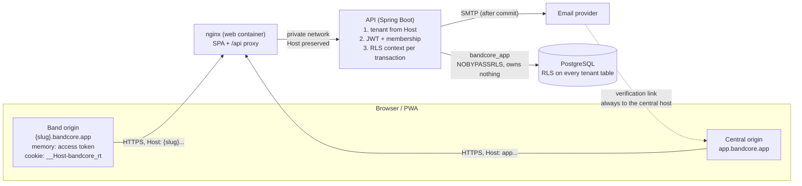

# Threat model: tenant isolation and authentication

- **Scope:** bands as tenants, tenant resolution, row-level security, accounts, sessions and roles ([M2](../roadmap/M02-multitenancy-auth-core.md)); offline data on phones ([M9](../roadmap/M09-offline-sales-pwa.md)) is listed so the mitigation is planned early.
- **Method:** STRIDE per element of the data flow below.
- **Last reviewed:** 2026-10-30 (M2-01). Reviewed again before launch in [M10-08](../roadmap/M10-production-readiness-lgpd.md).
- **Related:** [ADR-0002](../adr/0002-multi-tenancy-shared-schema-band-id-rls.md), [ADR-0003](../adr/0003-global-accounts-per-band-memberships.md), [ADR-0004](../adr/0004-authentication-jwt-and-rotating-refresh-cookie.md), [ADR-0005](../adr/0005-subdomain-per-band-same-origin-api.md), [permission matrix](permissions.md), [registering an endpoint](../endpoint-security.md).

## What we protect

| Asset | Why it matters |
|---|---|
| Band data (expenses, balances, sales, stock, members) | Financial data of a band; a leak to another band is the worst failure of the product |
| Accounts (email, password hash, sessions) | Takeover gives access to every band of the user |
| Refresh tokens | Long-lived (up to 30 days); whoever holds one can mint access tokens |
| Verification tokens (later: reset, invitation, handoff) | Single-use secrets sent by email or URL |
| Signing key (`JWT_SECRET`) | Whoever has it can forge a token for any band and role |

## Data flow

Trust boundaries: browser ↔ nginx (internet), nginx ↔ API (private network; only nginx can reach the API), API ↔ PostgreSQL (credentials per role), API → email provider (third party).

## Threats and mitigations

Risk: **H** high, **M** medium, **L** low (likelihood × impact, before the mitigation). Every high-risk threat has a test in the issue that implements its mitigation.

### Cross-tenant access

| ID | STRIDE | Threat | Risk | Mitigation | Issue and test |
|---|---|---|---|---|---|
| T01 | I, E | **IDOR**: band A's user sends band B's IDs in a path, query or body | H | Repositories always filter by the current band; RLS returns no rows for other bands; cross-tenant access answers 404, never 403 | [M2-04](https://github.com/Burst-Into-Fire/bandcore/issues/15), [M2-11](https://github.com/Burst-Into-Fire/bandcore/issues/22): `RowLevelSecurityIT`, `TenantIsolationIT` scenarios 2 and 3 |
| T02 | S | **`Host` header spoofing**: request for band B with a forged `Host` or `X-Forwarded-Host` | H | The band comes only from the normalized `Host`; `X-Forwarded-Host` only from configured trusted proxies; the JWT `aud` and `band_id` must match the host, and the membership is checked | [M2-03](https://github.com/Burst-Into-Fire/bandcore/issues/14), [M2-09](https://github.com/Burst-Into-Fire/bandcore/issues/20): `TenantResolutionIT`, `TokenValidationIT` |
| T03 | T, E | **Tampered `band_id` claim** or `alg: none` | H | HS256 only, signature verified with the server key; `alg` is not taken from the token | [M2-09](https://github.com/Burst-Into-Fire/bandcore/issues/20): `TokenValidationIT`, harness scenario 4 |
| T04 | S | **Token replay across subdomains**: band A's token sent to band B's host | H | `aud` is the host the token was issued for; `band_id` must equal the host's band; the membership is loaded for that band | [M2-09](https://github.com/Burst-Into-Fire/bandcore/issues/20): harness scenario 1 |
| T05 | I | **New table without RLS** | H | Tenant table checklist in [DATABASE.md](../DATABASE.md); schema guard fails the build for a table with `band_id` and no forced RLS, no policy, no `band_id` index or a foreign key without `band_id` | [M2-05](https://github.com/Burst-Into-Fire/bandcore/issues/16): `SchemaGuardIT` with a negative fixture |
| T06 | I | **Background job without tenant context** reads or writes everything | M | No role bypasses RLS; with no context, policies return nothing and reject writes; jobs run one transaction per band through `TenantContextHolder.callAs` | [M2-04](https://github.com/Burst-Into-Fire/bandcore/issues/15): `RowLevelSecurityIT` (no context → zero rows, inserts rejected) |
| T07 | I | **Tenant context leaks through the connection pool** | H | `set_config(…, true)` is transaction-local and set at the start of every transaction from the request; outside a transaction nothing is set | [M2-04](https://github.com/Burst-Into-Fire/bandcore/issues/15): `RowLevelSecurityPoolIT` with a pool of one connection |
| T08 | I | **Child row points to another band's parent** | M | Composite foreign keys `(band_id, …)` | [M2-04](https://github.com/Burst-Into-Fire/bandcore/issues/15): `RowLevelSecurityIT` |
| T09 | E | **Stale role or removed member** keeps access until the token expires | M | Membership and role loaded from the database on every request (cache ≤ 60 s, evicted on change); the JWT `role` is only a hint | [M2-09](https://github.com/Burst-Into-Fire/bandcore/issues/20): `TokenValidationIT` |
| T10 | E | **Endpoint added without authorization or isolation checks** | H | Every endpoint must be `@PublicEndpoint`, `@CentralEndpoint` or registered in the authorization matrix and the isolation harness, otherwise the build fails | [M2-10](https://github.com/Burst-Into-Fire/bandcore/issues/21), [M2-11](https://github.com/Burst-Into-Fire/bandcore/issues/22): `AuthorizationMatrixIT`, `TenantIsolationIT` |
| T11 | E | **`READ_ONLY` or `MEMBER` performs admin actions** | H | Named permissions per role in one place; `@PreAuthorize` on use cases | [M2-10](https://github.com/Burst-Into-Fire/bandcore/issues/21): `AuthorizationMatrixIT` |
| T12 | E | **Central-only endpoint reached on a band host** (or the other way round) | M | Endpoint scope checked before authentication; wrong host answers 404 | [M2-03](https://github.com/Burst-Into-Fire/bandcore/issues/14): `TenantResolutionIT` |

### Account takeover

| ID | STRIDE | Threat | Risk | Mitigation | Issue and test |
|---|---|---|---|---|---|
| T13 | S | **Credential stuffing** and password guessing | H | Argon2id; 12+ character passwords; common passwords rejected; generic login error; rate limiting and progressive delay in M3-02 | [M2-06](https://github.com/Burst-Into-Fire/bandcore/issues/17): `PasswordPolicyTest`, `SignupIT`; [M3-02](../roadmap/M03-security-hardening-delivery.md) |
| T14 | S, I | **Leaked verification token** (logs, email, history) | M | 256-bit random, only its SHA-256 hash is stored, single use, 24 h; tokens never logged; links point to the central host | [M2-06](https://github.com/Burst-Into-Fire/bandcore/issues/17): `SignupIT` (reused and expired tokens rejected) |
| T15 | S | **Stolen refresh token** | H | `HttpOnly`, `Secure`, `SameSite=Strict`, `__Host-` cookie; stored hashed; rotated on every use; reuse of a rotated token revokes the whole family; sliding 14 days, absolute 30 days; logout-all | [M2-07](https://github.com/Burst-Into-Fire/bandcore/issues/18): `RefreshTokenIT` |
| T16 | S | **Stolen access token** | M | 15-minute lifetime; kept only in memory, never in `localStorage`/`sessionStorage` | [M2-07](https://github.com/Burst-Into-Fire/bandcore/issues/18): `AccessTokenServiceTest`; [M2-12](https://github.com/Burst-Into-Fire/bandcore/issues/23): `session.test.ts` (storage spies) |
| T17 | I | **Signing key leaked** | M | Only in the platform's secret store; required in production (startup fails without it); at least 256 bits; `kid` header prepares rotation | [M2-07](https://github.com/Burst-Into-Fire/bandcore/issues/18): `ProductionConfigurationTest`, `JwtPropertiesTest` |
| T18 | S | **Unverified email used to act as someone else** | M | Unverified accounts cannot log in on band hosts, create bands or accept invitations | [M2-06](https://github.com/Burst-Into-Fire/bandcore/issues/17), [M2-08](https://github.com/Burst-Into-Fire/bandcore/issues/19): `LoginIT`, `BandCreationIT` |

### Enumeration

| ID | STRIDE | Threat | Risk | Mitigation | Issue and test |
|---|---|---|---|---|---|
| T19 | I | **Account enumeration** through signup, login or resend | M | Identical responses whether the email exists or not; the existing owner gets an email instead; the password encoder runs even for unknown emails | [M2-06](https://github.com/Burst-Into-Fire/bandcore/issues/17), [M2-07](https://github.com/Burst-Into-Fire/bandcore/issues/18): `SignupIT`, `LoginIT` (encoder spy) |
| T20 | I | **Band slug enumeration** | L | Accepted: a slug is a public subdomain by design. Slug availability requires a central session; rate limiting in M3-02. Band hosts reveal only the band name before login | [M2-08](https://github.com/Burst-Into-Fire/bandcore/issues/19); [M3-02](../roadmap/M03-security-hardening-delivery.md) |
| T21 | I | **Probing other bands' IDs** | M | UUIDv7 identifiers; other bands' resources answer 404, never 403 | [M2-11](https://github.com/Burst-Into-Fire/bandcore/issues/22): `TenantIsolationIT` |

### Browser

| ID | STRIDE | Threat | Risk | Mitigation | Issue and test |
|---|---|---|---|---|---|
| T22 | T | **CSRF** on cookie-based endpoints (refresh, logout) and login CSRF | H | Same-origin API, no CORS; `SameSite=Strict` cookie; unsafe requests without a bearer token must carry `X-Requested-With`, which a cross-site form cannot send without a CORS preflight | [M2-07](https://github.com/Burst-Into-Fire/bandcore/issues/18): `RefreshTokenIT` (refresh without the header → 403) |
| T23 | I | **XSS stealing tokens** | H | Access token only in memory; refresh token `HttpOnly`; React escapes output; CSP in M3-04 | [M2-12](https://github.com/Burst-Into-Fire/bandcore/issues/23); [M3-04](../roadmap/M03-security-hardening-delivery.md) |
| T24 | I | **Session or storage shared between bands in the browser** | M | One origin per band: cookies, storage and IndexedDB are isolated by the browser; the refresh cookie has no `Domain` | ADR-0005; [M3-05](../roadmap/M03-security-hardening-delivery.md) E2E isolation journey |
| T25 | I | **Offline data left on a shared phone** (catalog, queued sales) | M | Data per band origin; logout clears memory, the query cache and (M9) the offline queue after it synced; nothing personal beyond what the sale needs | [M9](../roadmap/M09-offline-sales-pwa.md) |

### Infrastructure and operations

| ID | STRIDE | Threat | Risk | Mitigation | Issue and test |
|---|---|---|---|---|---|
| T26 | E | **Runtime role can bypass RLS** (owner, superuser, `BYPASSRLS`) | H | Flyway runs as `bandcore_owner`; the API as `bandcore_app` (no superuser, no `BYPASSRLS`, owns nothing) | [M1-04](../roadmap/M01-project-foundation.md), [M2-05](https://github.com/Burst-Into-Fire/bandcore/issues/16): `DatabaseRolesIT`, `SchemaGuardIT` |
| T27 | I | **Secrets or personal data in logs and error responses** | M | Problem Details without exception messages; tokens, passwords and full emails never logged (emails masked) | [M1-03](../roadmap/M01-project-foundation.md): `ProblemDetailsIT`; [M2-06](https://github.com/Burst-Into-Fire/bandcore/issues/17) |
| T28 | R | **No trace of security events** (logins, token reuse) | M | Security and audit events in M3-03 | [M3-03](../roadmap/M03-security-hardening-delivery.md) |
| T29 | D | **Brute force or flooding** of signup, login, resend and slug checks | M | Rate limiting in M3-02; email sending happens after commit and off the request thread | [M3-02](../roadmap/M03-security-hardening-delivery.md) |

## Residual risks

- Until M3-02, login, signup and resend have no rate limit. Do not expose the API publicly before M3-02 is done.
- Access tokens cannot be revoked during their 15 minutes; membership changes still take effect on the next request (T09).
- Two tabs of the same band refreshing at the same moment can trigger reuse detection and log the user out. The web app shares one refresh per tab; the cost is a new login, never a leak.
- `JWT_SECRET` rotation needs a second key in the decoder; the `kid` header is already set.

## Review checklist for pull requests

Use it for every change that touches authentication, tenancy, a new table or a new endpoint.

- [ ] The band comes only from `TenantContextHolder` (the host), never from the body, query or a header
- [ ] New tenant tables follow the [tenant table checklist](../DATABASE.md#tenant-table-checklist); `SchemaGuardIT` passes without adding the table to the global allowlist
- [ ] New endpoints are `@PublicEndpoint` (with a reason), `@CentralEndpoint`, or registered in `AuthorizationMatrix` and `IsolationScenarios` ([guide](../endpoint-security.md))
- [ ] Use cases have `@PreAuthorize` with a named permission; ownership rules ("own only") are checked in the service
- [ ] Another band's resources answer 404, and responses never contain other bands' IDs or names
- [ ] Tenant data is accessed only inside transactions
- [ ] No token, password, full email or secret in logs, error responses or URLs that reach the server
- [ ] Generic errors where a specific one would reveal whether an account or resource exists
- [ ] Cookies: `__Host-` prefix, `Secure`, `HttpOnly`, `SameSite=Strict`; unsafe cookie-authenticated requests require `X-Requested-With`
